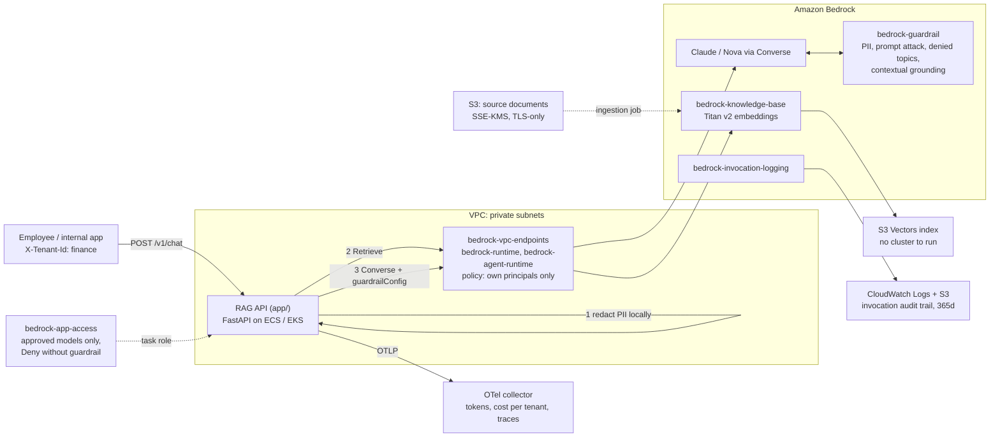

# aws-genai-platform

[](https://github.com/Krustytoe/aws-genai-platform/actions/workflows/terraform.yml) [](https://github.com/Krustytoe/aws-genai-platform/actions/workflows/app.yml) [](https://github.com/Krustytoe/aws-genai-platform/releases/latest) [](LICENSE)

A production-shaped **retrieval-augmented generation (RAG) platform on Amazon Bedrock**: Terraform for the guardrailed, private, audited AI infrastructure, a FastAPI service that answers questions only from approved documents (with citations), and an eval suite that gates every change.

Built to work **unchanged in AWS commercial and GovCloud**: partition-aware ARNs, nothing hard-coded to `arn:aws:`.

> Azure version: [azure-genai-platform](https://github.com/Krustytoe/azure-genai-platform). It uses the same API contract, eval suite and design principles on Azure OpenAI + AI Search.

## What problem this solves

Most enterprise GenAI pilots stall on the same questions from security, compliance and finance:

| Question | Answer in this repo |
|---|---|
| *Can it leak PII or credentials?* | PII is redacted locally before any call **and** by the Bedrock guardrail. The API never logs prompt or answer text. |
| *Will it make things up?* | No relevant source means no model call, just a fixed refusal. Answers must cite sources, and the guardrail's contextual-grounding check blocks unsupported answers. |
| *Can someone bypass the guardrail?* | IAM **explicitly denies** model invocation without the guardrail, whatever other policies allow. |
| *Does our data leave the network?* | Bedrock runtime traffic goes through VPC interface endpoints, and the endpoint policy only admits your own principals. |
| *Who's spending what?* | Every request emits OpenTelemetry token and cost metrics tagged by tenant (team), so spend can be shown back or charged back. |
| *Can we audit it?* | Bedrock invocation logging to KMS-encrypted CloudWatch + S3, 365-day retention. |
| *How do we know a change didn't make it worse?* | A promptfoo eval and red-team suite runs on every PR, and on demand against a live environment. |

## Architecture



## What's inside

| Path | What it is |
|---|---|
| [`terraform/modules/bedrock-guardrail`](terraform/modules/bedrock-guardrail) | Harm filters, prompt-attack detection, PII block/mask, denied topics, grounding checks. Published as an immutable version |
| [`terraform/modules/bedrock-knowledge-base`](terraform/modules/bedrock-knowledge-base) | Knowledge base on **S3 Vectors** + KMS-encrypted docs bucket + scoped service role |
| [`terraform/modules/bedrock-invocation-logging`](terraform/modules/bedrock-invocation-logging) | Region-wide invocation audit logging to CloudWatch + S3 with a rotating CMK |
| [`terraform/modules/bedrock-app-access`](terraform/modules/bedrock-app-access) | Least-privilege app policy, with the guardrail enforced by explicit Deny |
| [`terraform/modules/bedrock-vpc-endpoints`](terraform/modules/bedrock-vpc-endpoints) | Private Bedrock endpoints with an account/org-scoped endpoint policy |
| [`terraform/examples/complete`](terraform/examples/complete) | Wires everything together and outputs the app's environment variables |
| [`app/`](app) | The RAG API: redaction, score gating, citations, OpenTelemetry GenAI metrics |
| [`evals/`](evals) | promptfoo suite (accuracy, refusal, PII, prompt injection) and a sample policy corpus |
| [`scripts/sync-knowledge-base.sh`](scripts/sync-knowledge-base.sh) | Uploads documents and runs and waits for an ingestion job |

## Quick start

**Offline in under a minute**, with no AWS account (uses the built-in `fake` provider):

```bash
cd app
uv sync
RAG_PROVIDER=fake uv run uvicorn --factory ragapi.main:create_app --port 8080

curl -s localhost:8080/v1/chat -H 'content-type: application/json' -H 'x-tenant-id: finance' \
  -d '{"question":"What is the domestic meal per diem?"}' | jq
```

**Run the eval suite** against it (another terminal):

```bash
RAG_API_URL=http://localhost:8080 npx promptfoo@0.125.1 eval -c evals/promptfooconfig.yaml
```

**Deploy to AWS:**

```bash
cd terraform/examples/complete
terraform init
terraform apply -var vpc_id=... -var 'private_subnet_ids=["..."]' \
  -var app_security_group_id=... -var app_role_name=...

# Load the sample corpus (or your own documents) into the knowledge base
eval "$(terraform output -json ingestion | jq -r '"b=\(.docs_bucket) k=\(.knowledge_base_id) d=\(.data_source_id)"')"
../../../scripts/sync-knowledge-base.sh ../../../evals/corpus "$b" "$k" "$d"

# Environment for the container
terraform output -json app_environment
```

Enable access to the chat model and Titan Text Embeddings v2 in the Bedrock console for your region first.

## Design decisions

- **Defense in depth on data, not one control.** PII is redacted in-process before retrieval and generation, the guardrail blocks or masks PII again on both input and output, and logs never include prompt or answer text. Any single layer can fail without exposing data.
- **Refuse before you spend.** If retrieval returns nothing above `RAG_MIN_SCORE`, the API returns a fixed refusal without calling the model. Out-of-scope questions cost nothing and can't produce a hallucinated answer.
- **Guardrails are a platform control, not an app setting.** The app passes the guardrail, but IAM is what *requires* it. An explicit Deny on `bedrock:GuardrailIdentifier` means a misconfigured or malicious client can't call the model without it.
- **Pin guardrail versions.** Apps run against an immutable, published guardrail version. A console edit to the draft can't change production behaviour, and old versions are kept so a rollout can be rolled back.
- **S3 Vectors over OpenSearch Serverless.** OpenSearch Serverless bills a minimum OCU count around the clock. For internal Q&A traffic, S3 Vectors removes that fixed cost and there's no cluster to operate.
- **Vendor-neutral telemetry.** Metrics and spans follow the OpenTelemetry GenAI semantic conventions (`gen_ai.client.token.usage`, `gen_ai.request.model`) and export over OTLP, to CloudWatch via ADOT, Grafana, Datadog or Langfuse, with no code changes.
- **Evals are tests.** The promptfoo suite runs in CI against the real API binary on every PR, with an offline provider so it's free and deterministic. The same suite runs against a deployed environment on demand to measure the real model.
- **Provider-neutral core.** The pipeline depends only on small `Retriever` and `ChatModel` protocols. The Bedrock adapter is about 125 lines, and the [Azure repo](https://github.com/Krustytoe/azure-genai-platform) swaps in Azure OpenAI + AI Search without touching the pipeline.

## CI

| Workflow | What it checks |
|---|---|
| `terraform` | `fmt`, `validate`, `terraform test` (mocked providers, no credentials), and `tflint` for every module |
| `app` | ruff, pytest (90% coverage gate), promptfoo evals against the running API, Docker build + non-root smoke test + Trivy image scan |
| `security` | Trivy IaC misconfiguration and dependency scans to the Security tab, plus a weekly re-scan |
| `evals-deployed` | Manual: run the eval suite against a deployed URL |
| `release-please` | Conventional-commit releases and changelog |

## Related

- [terraform-aws-platform-modules](https://github.com/Krustytoe/terraform-aws-platform-modules): VPC, GitHub OIDC role and alerting modules this stack sits on
- [platform-workflows](https://github.com/Krustytoe/platform-workflows): the reusable Trivy workflow used here
- [observability-as-code](https://github.com/Krustytoe/observability-as-code): dashboards and alerting as code

## License

[MIT](LICENSE)
